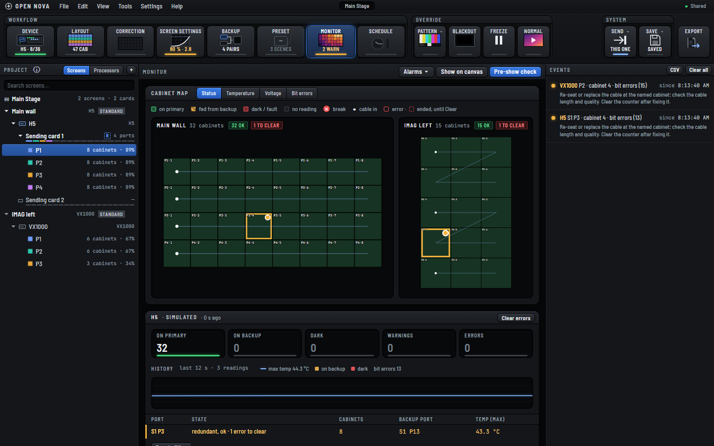

<p align="center">

</p>

<h1 align="center">Open Nova</h1>

<p align="center">
<strong>Open-source control for NovaStar LED processors.</strong><br />
Map an LED wall, send it to the processor, set up redundancy, adjust colour and watch the wall's health, for H series,
VX, MCTRL, VX Pro (Unico) and MX (COEX) processors, from one app on Windows, macOS and Linux.
</p>

<!-- Placeholders until the first public release and the website exist: the download buttons open the releases page
(alpha builds are pre-releases, so releases/latest has nothing yet) and "Website" opens the repository. -->

<div align="center">


</div>

<p align="center">
<a href="https://github.com/kman1898/Open-Nova">Website</a> ·
<a href="https://github.com/kman1898/Open-Nova/releases">Download</a> ·
<a href="docs/RUNNING.md">Documentation</a> ·
<a href="ROADMAP.md">Roadmap</a> ·
<a href="https://github.com/kman1898/Open-Nova/issues/new/choose">Report a problem</a>
</p>

<p align="center">
<a href="https://github.com/kman1898/Open-Nova/actions/workflows/ci.yml?query=branch%3Amain"></a>
<a href="https://github.com/kman1898/Open-Nova/releases"></a>
<a href="#licence"></a>

</p>


*Layout: one screen on four ports of an H5, every port with a backup port. Shown in an offline project, where the
processors are simulated.*

## Download

Open Nova is in **early alpha**. Each release has one zip that runs on Windows, macOS and Linux:
`OpenNova-<version>-alpha.zip` from the [releases page][releases]. Unzip it anywhere, then double-click
**Start Open Nova.bat** (Windows), **Start Open Nova.command** (macOS) or run `./start-open-nova.sh` (Linux). The app
opens in your browser; leave the small window open while you work.

- **Needs Python 3.9 or newer** and nothing else ([python.org](https://www.python.org/downloads/)). Nothing to install on Windows or macOS: without a usable Python, the first start fetches one into the Open Nova folder.
- **Read-only by default.** The alpha finds, reads and monitors processors. Everything that writes to one (Send, Save, colour, test patterns, Blackout, receiving-card files …) stays locked until you enter the unlock code: ask whoever gave you the build. The code is a speed bump against sending by accident, not a password.
- **The downloads aren't signed yet.** On Windows, if SmartScreen says "Windows protected your PC", choose **More info**, then **Run anyway**. On macOS, the first time: right-click **Start Open Nova.command** ▸ **Open** (macOS 14 or older), or on macOS 15 and newer click Done, then System Settings ▸ Privacy & Security ▸ **Open Anyway**.

Each release also lists `SHA256SUMS.txt`. More in [docs/RUNNING.md](docs/RUNNING.md) and, for testers,
[docs/README-ALPHA.md](docs/README-ALPHA.md).

## What works

Early, and honest about it. Open Nova talks to three families of NovaStar processor. How far each one has been checked:

| Processors                                                     | How it talks                               | Checked                                                                                                                                                                                                                                                                                                                                                               |
|----------------------------------------------------------------|--------------------------------------------|-----------------------------------------------------------------------------------------------------------------------------------------------------------------------------------------------------------------------------------------------------------------------------------------------------------------------------------------------------------------------|
| **H series** (H2, H5, H9, H15, H20 and their output cards)     | NovaLCT's protocol, over the network       | **Live, read-only** on an H2 and an H5 (firmware V2.2.0.1): found, linked, cards and models read; colour settings read on the H5. **Send plans checked against NovaLCT's own Send, byte for byte**, from recordings of NovaLCT sending to H-series processors (standard and complex screens, free topology, redundancy), apart from a few known, tracked differences. |
| **VX, MCTRL, NovaPro** (NovaLCT family)                        | NovaLCT's protocol, network, USB or serial | **Live** on a VX1000 (Ethernet and USB: found and linked) and a tester's VX4S-N over USB (Send, Save, Detect, test patterns). The rest on fakes. |
| **VX Pro** (Unico: VX400 / 600 / 1000 / 2000 Pro)              | Unico's REST interface                     | **Fakes only**, built from recordings of Unico's own app. Not yet on a real VX Pro.                                                                                                                                                                                                                                                                                   |
| **MX / CX** (COEX: MX40 Pro, MX2000 Pro, MX6000 Pro, CX40 Pro) | VMP's REST interface                       | **Fakes only**, built from recordings of VMP with NovaStar's emulator. Not yet on a real controller.                                                                                                                                                                                                                                                                  |

What the app does today:

- **Layout:** screens, cabinets and wiring (serpentine and raster patterns, or by hand), port capacity per card, quick add, align and distribute, complex screens, undo.
- **Send and Save:** Send, Dry run and Compare per processor; Save is always its own button, never part of a Send.
- **Redundancy:** port-to-port backup sets, Send backup and Verify, as NovaLCT does it.
- **Screen settings:** brightness, gamma, colour temperature and gamut, sent as you move the control and read back from the processor. NovaLCT's colour temperature frames are checked byte for byte.
- **Custom gamut on NovaLCT processors:** the same settings as NovaLCT's Configure Color Space, your LEDs' colours and the target.
- **LUTs on NovaLCT processors:** load a `.cube` or `.3dl`; it is fitted to custom gamma and the gamut, and you see how close it gets before anything is sent. The cards have no real 3-D LUT, so looks that bend one colour range won't carry over.
- **Test and override:** Blackout, Freeze, Normal, test patterns, identify a cabinet.
- **Monitor:** temperature, voltage, bit errors and power supplies per cabinet; errors stay until you clear them.
- **Files:** NovaLCT `.scr` (standard and complex) export and import, `.scfg`, Unico screen and VMP project import.
- **Receiving-card files:** NCP sends behind a guard that checks the file against the cards first.
- **Offline and online projects**, kept apart as in VMP. Offline, every processor is simulated, so every tab works without hardware, calibration and monitoring included.
- **Networks:** finds processors on every network adapter at once (Settings ▸ Network), and copes with two networks that use the same addresses.
- **Diagnostics:** every byte to and from the processors is recorded locally (passwords never), and one click makes a report. When something goes wrong, the app offers to make one.

Writes to real processors are what the alpha is for: the live checks still open are listed in [ROADMAP.md](ROADMAP.md).
Calibration coefficients, firmware updates and editing receiving-card files are out of scope.



*Monitor: each screen's cabinets, the counts per processor and the events, which stay until you clear them (offline
project, simulated processors).*

## Report a problem

In the app, **Help ▸ Report a Problem…** makes one zip in your Downloads folder: a readable summary, the recording of
what Open Nova sent to and received from your processors, and the logs. Passwords are never recorded, and you can
replace your network addresses with device-A, device-B … before you save it. Nothing is uploaded: open an
[issue](https://github.com/kman1898/Open-Nova/issues/new/choose) and attach the zip, with the version from
**Help ▸ About**. Details: [docs/DIAGNOSTICS.md](docs/DIAGNOSTICS.md).

A processor Open Nova doesn't know yet? Connect it once and send a report: Open Nova keeps a snapshot of what the
processor said, which is usually enough to add it.

## Build from source and run the tests

```sh
git clone https://github.com/kman1898/Open-Nova && cd Open-Nova
python3 opennova.py                       # the app (on Windows: py -3 opennova.py)
python3 tools/run_tests.py                # every Python and node test (needs node for the plan tests)
python3 tools/browser_tests.py            # the browser test pages (pip install playwright; python -m playwright install chromium)
python3 tools/make_package.py --out dist  # the zip; --alpha for the read-only alpha build
```

The app is Python's standard library and a browser page: nothing to install, no build step. How the tests and CI fit
together is in [docs/TESTING.md](docs/TESTING.md); how to send a change is in [CONTRIBUTING.md](CONTRIBUTING.md).
Security problems: [SECURITY.md](SECURITY.md).

## Disclaimer

Open Nova sends commands to live LED processors. It is provided as is, without warranty, and a qualified person must
check what it does before it is used on a show: read [DISCLAIMER.md](DISCLAIMER.md).

## Licence

MIT OR Apache-2.0, at your option ([LICENSE-MIT](LICENSE-MIT), [LICENSE-APACHE](LICENSE-APACHE)). Bundled fonts keep
their own licence (SIL Open Font License 1.1); see [NOTICE](NOTICE).

Open Nova is independent. It is not affiliated with, sponsored by or endorsed by NovaStar or any other manufacturer.
NovaStar, NovaLCT, VMP, Unico, COEX and the product names above are trademarks of their owners, named only to describe
compatibility.

[releases]: https://github.com/kman1898/Open-Nova/releases
